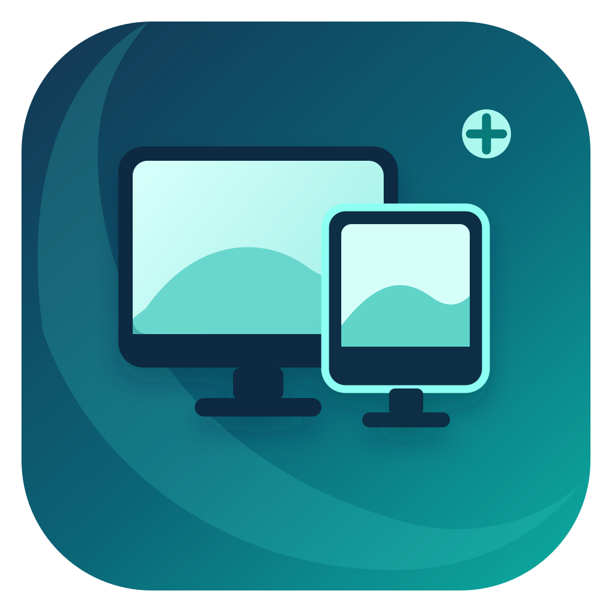

# Mac Monitor



Ứng dụng menu bar cho macOS: ngắt/kết nối màn hình bằng phần mềm, chỉnh độ sáng và chọn độ phân giải/HiDPI.

[English](README.en.md) · [Tải bản beta](https://github.com/kidside/mac-monitor/releases) · [Hướng dẫn cài đặt](docs/INSTALL.md)

## Cài đặt

Bản đầu tiên: **0.2.0-beta.2**, dành cho **Mac Apple Silicon**, macOS **14 trở lên**. Hiện mới thử thực tế trên M4 Pro với macOS 27.0.1; chưa xác nhận các phiên bản khác. Giao diện có tiếng Việt và tiếng Anh.

1. Tải `MacMonitor-0.2.0-beta.2-arm64.zip` từ Releases, giải nén và kéo **Mac Monitor.app** vào **Applications**.
2. Mở ứng dụng, bấm biểu tượng màn hình trên menu bar.
3. Muốn dùng phím tăng/giảm sáng toàn hệ thống: bật **Mac Monitor** trong **System Settings → Privacy & Security → Accessibility**. Thanh trượt vẫn dùng được khi chưa cấp quyền này.

Bản beta được ký ad-hoc, **chưa được Apple notarize**. macOS có thể chặn lần mở đầu; nếu bạn tin nguồn tải, làm theo [hướng dẫn Open Anyway của Apple](https://support.apple.com/en-us/102445). Không cần tắt Gatekeeper. Bản ad-hoc mới có thể cần cấp lại quyền Trợ năng; nên giữ ứng dụng ở một đường dẫn cố định.

Để tự mở khi đăng nhập, thêm bản trong Applications vào **System Settings → General → Login Items & Extensions → Open at Login**.

## Điều khiển

- Công tắc từng màn hình gửi yêu cầu ngắt/kết nối bằng phần mềm. Giữ ít nhất một màn hình hoạt động.
- **Độ phân giải & HiDPI** liệt kê chế độ màn hình cung cấp. Ưu tiên chế độ có nhãn HiDPI sẵn.
- Nếu cần, tạo màn hình ảo HiDPI 2× rồi mirror lên màn hình thật. Chọn kích thước theo tỉ lệ màn và tần số quét được cung cấp; ứng dụng phải tiếp tục chạy.
- Phím có biểu tượng mặt trời điều chỉnh màn hình dưới con trỏ mặc định, không cần giữ Fn. Trong cài đặt có thể chọn một màn hình hoặc tất cả. Phím chức năng F1/F2 thông thường được chuyển tiếp cho ứng dụng khác.
- Tắt bằng công tắc giữ màn hình ở trạng thái ngắt cho đến khi bạn bật lại. Chỉ đổi độ phân giải/HiDPI có thời hạn xác nhận 20 giây. **Khôi phục tất cả** dùng khi cấu hình không như ý. Khi thoát hoặc dừng bất ngờ, ứng dụng cố gắng khôi phục cấu hình đã lưu; đây không phải bảo đảm cho mọi phần cứng.

Ứng dụng liệt kê màn hình theo thiết bị thực tế, không giới hạn cố định hai màn hình. Số màn có thể dùng phụ thuộc Mac, cổng, adapter và macOS.

## Độ sáng

Dòng dưới thanh trượt cho biết cách điều khiển:

- **DDC**: chỉnh đèn nền thật qua DDC/CI, đọc lại để hiển thị giá trị màn hình xác nhận. Mức 0% là đèn nền tối thiểu của màn, không phải ngắt kết nối.
- **Giảm sáng phần mềm**: dùng khi chưa có phản hồi DDC hợp lệ. Mức 100% bỏ lớp giảm sáng, không tăng được đèn nền vật lý. Khi đó chỉnh đèn nền bằng nút trên màn hình.
Khi mở app, Mac Monitor chỉ đọc độ sáng DDC hiện tại, không tự chỉnh đèn nền. Lớp giảm sáng phần mềm bắt đầu ở trạng thái tắt; bạn có thể bật hoặc chỉnh lại khi cần.

- **Giảm sáng thêm bằng phần mềm**: tùy chọn dành cho màn có DDC nhưng vẫn quá sáng ở mức thấp. Kết hợp đèn nền và lớp giảm sáng, giữ mức phần mềm tối thiểu 5% để còn nhìn được.

DDC đã thử thành công với **Mi Monitor qua HDMI tích hợp** và **VU241Q qua USB-C**. Hỗ trợ trên màn/cáp/adapter khác chưa được xác nhận. Bật DDC/CI trong menu màn hình nếu thiết bị có tùy chọn đó. Phản hồi lỗi hoặc thiếu dữ liệu không bị diễn giải thành độ sáng 0%.

## HiDPI và giới hạn beta

HiDPI không chỉ dành cho màn 2K. Chế độ sử dụng được phụ thuộc màn hình và macOS; chất lượng còn phụ thuộc độ phân giải vật lý. Luồng màn ảo hiện mới được thử ở hai màn hình dưới đây, chưa thử Full HD, 4K, màn dọc hay ultrawide. Không bảo đảm mọi độ phân giải hoặc tần số quét.

| Máy thử | Màn hình | Kết nối | Chế độ HiDPI đã thử |
| --- | --- | --- | --- |
| M4 Pro, macOS 27.0.1 | Mi Monitor 27″ | HDMI tích hợp | 1920 × 1080, 100 Hz |
| M4 Pro, macOS 27.0.1 | VU241Q 24″, 2560 × 1440 | USB-C | 1920 × 1080, 75 Hz |

Ngắt màn hình và tạo màn ảo dùng API riêng của macOS, có thể thay đổi khi cập nhật hệ điều hành. Dự án dành cho phân phối trực tiếp, chưa hướng đến Mac App Store.

## Tự build

Cần Mac Apple Silicon và Xcode Command Line Tools. Nếu chưa có, cài bằng `xcode-select --install`, rồi chạy:

```sh
./scripts/build.sh
./scripts/test.sh
open 'build/Mac Monitor.app'
```

Không cần tải thêm thư viện: mã nguồn helper DDC đã có trong Vendor. Build thường ưu tiên chứng chỉ Apple Development sẵn có để giữ quyền Trợ năng ổn định. Nếu không có chứng chỉ, dùng chữ ký ad-hoc.

Để build riêng khi ứng dụng đang chạy:

```sh
MAC_MONITOR_BUILD_DIR=build-preview MAC_MONITOR_SIGNING_IDENTITY=- ./scripts/build.sh
MAC_MONITOR_BUILD_DIR=build-preview ./scripts/test.sh
```

Tạo gói phát hành riêng trong `dist/`, không thay bản đang chạy ở `build/`:

```sh
./scripts/package-release.sh
```

Xem [quy trình phát hành](docs/RELEASING.md) và [hướng dẫn đóng góp](CONTRIBUTING.md).

## Dữ liệu và giấy phép

Ứng dụng không có tài khoản, telemetry hay yêu cầu mạng. Cấu hình và dữ liệu khôi phục lưu cục bộ. Quyền Trợ năng dùng để nhận diện phím sáng, không ghi nội dung bạn gõ. Khi báo lỗi, không đăng nguyên bản chẩn đoán có số serial/UUID thiết bị.

Mã nguồn và icon: [MIT](LICENSE). Helper [m1ddc](https://github.com/waydabber/m1ddc) cũng dùng MIT; xem [Third-party notices](THIRD_PARTY_NOTICES.md).

## HiDPI mở rộng

Trong thẻ màn hình, mở **Độ phân giải & HiDPI** để chọn mức “trông như”, Hz và **Trực tiếp / Màn ảo**. Thanh kích thước chỉ xem trước; bấm **Áp dụng HiDPI** để đổi và xác nhận trong 20 giây. Có thể thêm chiều rộng tùy chỉnh; chiều cao giữ theo tỉ lệ màn.

Nếu mức chưa có trực tiếp, dùng **Bổ sung các mức HiDPI vào macOS…**. Tính năng này cần bản Developer ID đã notarize, cho phép dịch vụ ở Login Items & Extensions và cấp quyền quản trị cho thao tác. Bản ký ad-hoc từ chối cài/gỡ cấu hình hệ thống, không dùng cơ chế nâng quyền cũ; HiDPI có sẵn và màn ảo vẫn dùng bình thường. Cấu hình áp dụng cho các màn cùng Vendor/Product, giữ bản sao trước khi ghi. Kết nối lại dây hoặc khởi động lại Mac rồi làm mới. **Gỡ cấu hình HiDPI của Mac Monitor…** trả lại cấu hình cũ; nếu app khác đã sửa file, Mac Monitor từ chối ghi đè. Không cần tắt SIP.

Màn ảo cần app chạy, chỉ phản chiếu, chưa có streaming. Hz và các mode tùy chỉnh phụ thuộc macOS; app kiểm tra sau khi áp dụng và quay lại nếu không đúng. Mức 1808×1017 và 2048×1152 HiDPI 75 Hz đã thử trên VU241Q. Cấu hình trực tiếp bổ sung cần được xác minh sau khi macOS nạp override; chưa khẳng định mọi mode trên mọi màn đều hoạt động.

## Ngôn ngữ

Mở nút cài đặt trên góc phải app, chọn **Ngôn ngữ**: **Tự động (theo macOS)**, **Tiếng Việt**, hoặc **English**. Ngôn ngữ tự động dùng tiếng Việt nếu ngôn ngữ ưu tiên của macOS là tiếng Việt; các ngôn ngữ khác dùng tiếng Anh. Lựa chọn được lưu và đổi ngay, không thay đổi cấu hình màn hình.

## Màn hình chính

Bấm **Đặt làm màn hình chính** trên thẻ màn đang kết nối, hoặc vào phần cài đặt và chọn **Chọn màn hình chính** (bao gồm màn MacBook đang hoạt động). App đổi gốc tọa độ cùng lúc cho các màn để giữ nguyên vị trí tương đối, và kiểm tra lại màn chính sau khi áp dụng. Mở app không áp lại bố cục cũ lên các màn đang hoạt động; thoát bình thường giữ bố cục native hiện tại.


## Bảo mật và chẩn đoán

Xem [chính sách bảo mật](SECURITY.md) và [kiểm tra trước phát hành](docs/SECURITY-CHECKS.md). Bản 0.2.0-beta.2 chuyển phần cài cấu hình hệ thống sang SMAppService/XPC. Dịch vụ mới chưa được kiểm tra cài/gỡ thực tế vì môi trường phát triển chưa có Developer ID/notarization; chưa quảng bá tính năng đó là sẵn sàng dùng trên bản tải ad-hoc.

`MacMonitor --diagnostics` xuất thông tin kiểm tra đã bỏ UUID/serial. Vẫn xem lại model màn và phiên bản hệ điều hành trước khi đăng công khai. `--diagnostics-private` chứa UUID, chỉ dùng cục bộ. `--trace-popover` gửi sự kiện đóng/mở vào OSLog; app không ghi tệp trace cố định trong `/tmp`.

Trước khi gỡ app, gỡ cấu hình HiDPI đã cài ở từng màn bằng bản notarized, rồi chọn **Gỡ dịch vụ quản trị…** trong cài đặt app. Gỡ dịch vụ không xóa cấu hình hoặc backup. Các chế độ HiDPI có sẵn, màn ảo, độ sáng và chọn màn chính không cần dịch vụ này.
